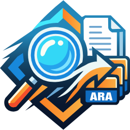
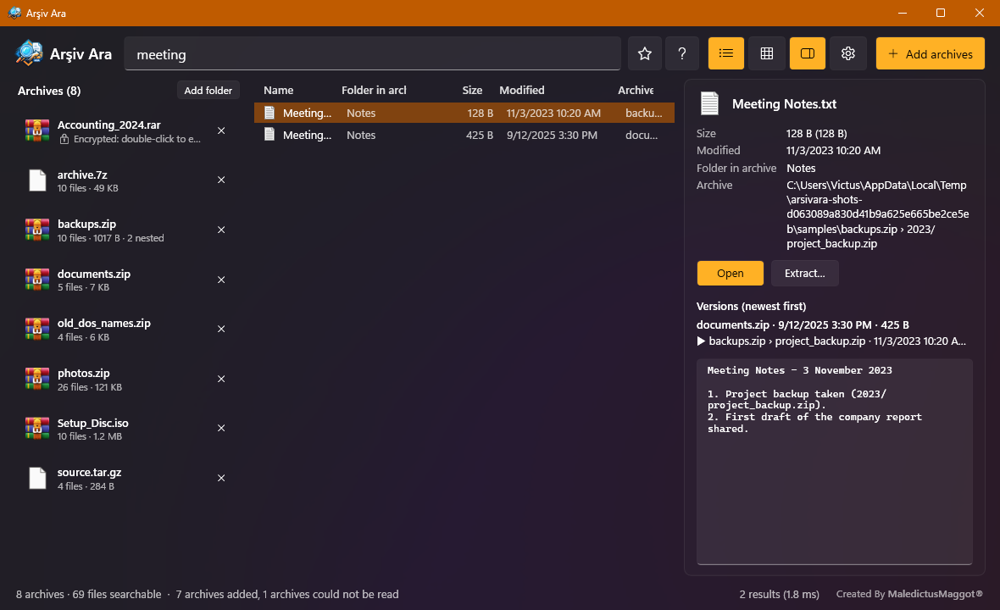

<div align="center">



# Arşiv Ara

**Sofortige Suche in ZIP-, RAR-, 7z-, TAR- und ISO-Archiven, ohne sie zu entpacken.**

Archive hineinziehen (oder alle finden lassen), ein paar Buchstaben tippen und jede passende Datei in Millisekunden sehen.

[English](README.md) · [Türkçe](README.tr.md) · **Deutsch** · [Español](README.es.md)

[](https://github.com/ekink07/ArchiveSearch/releases/latest)
[](https://github.com/ekink07/ArchiveSearch/actions/workflows/ci.yml)


[](#lizenz)



</div>

## Warum

Backups, Projektordner und Downloads werden zu Dutzenden großer Archive. Um eine einzelne Datei zu finden, muss man sie nacheinander öffnen.
Arşiv Ara liest nur das Inhaltsverzeichnis der Archive, hält es im Speicher und durchsucht alle gleichzeitig,
so wie [Everything](https://www.voidtools.com/) Dateinamen auf der Festplatte durchsucht.

## Funktionen

| | |
|---|---|
| **Drag & Drop oder ganze Laufwerke** | Archive oder Ordner auf das Fenster (oder die exe) ziehen oder alle Archive des Rechners finden lassen. Neue und geänderte Archive werden live erkannt. |
| **Sofortsuche** | 1 Million Dateinamen in 2–20 ms. Jeder Tastendruck aktualisiert die Ergebnisse. |
| **Suchsyntax** | ODER `a\|b`, NICHT `!entwurf`, `"genaue Phrase"`, Platzhalter `*.pdf`, `size:`, `date:`, `regex:`, `dupe:`, `content:`. Suchen mit `Strg + S` speichern. |
| **Tolerante Suche** | Groß-/Kleinschreibung und Akzente werden ignoriert: `sirket` findet `Şirket`. Alte ZIPs mit DOS-Dateinamen (CP857) werden richtig dekodiert. |
| **Formate** | ZIP, RAR (auch mehrteilig, RAR4/RAR5), 7z, TAR (`.gz`, `.bz2`, `.xz`, `.zst`, `.tgz`), ISO (ISO 9660, Joliet, Rock Ridge, UDF). Auch Archive in Archiven werden erfasst. |
| **Verschlüsselte Archive** | RAR und 7z mit verschlüsselten Dateinamen: Doppelklick, Kennwort eingeben, auf Wunsch mit Windows-DPAPI gespeichert. AES-ZIPs werden ohne Kennwort aufgelistet. |
| **Vorschau** | `Alt + P`: Bilder, Textdateien sowie Word-, Excel-, PowerPoint- und OpenDocument-Text, dazu alle anderen Versionen derselben Datei. |
| **Versionen und Duplikate** | Rechtsklick › *Versionen* zeigt, welches Backup die neueste Kopie einer Datei enthält; `dupe:` findet identische Dateien über Größe und CRC. |
| **Entpacken und ziehen** | `Strg + E` entpackt die Auswahl in einen Ordner; Treffer lassen sich direkt in den Explorer ziehen. |
| **Liste, Kacheln, Sortierung** | Windows-Symbole, Foto-Vorschaubilder, `Strg + Mausrad` von 16 bis 256 px. Ein Klick auf den Spaltenkopf sortiert. |
| **Sicher** | Entpackte Dateien behalten das Mark of the Web des Archivs; Programme und Skripte fragen vor dem Öffnen nach. Komplett offline. |
| **Portabel, 4 Sprachen** | Eine exe für x64 oder ARM64, keine Installation, kein .NET. Standardmäßig Englisch; Deutsch, Türkçe und Español in den *Einstellungen*. |

## Installation

**PowerShell (eine Zeile)**: wählt die x64- oder ARM64-Version, prüft SHA256, installiert nach `%LOCALAPPDATA%\Programs\ArsivAra`
und trägt sie ins Startmenü und unter *Einstellungen › Apps* ein (dort auch deinstallieren). Keine Administratorrechte nötig.

```powershell
irm https://raw.githubusercontent.com/ekink07/ArchiveSearch/main/install.ps1 | iex
```

Optionen: `-Desktop` (Desktop-Verknüpfung), `-Uninstall`, `-Uninstall -RemoveData` (auch Einstellungen und Bibliothek löschen):

```powershell
& ([scriptblock]::Create((irm https://raw.githubusercontent.com/ekink07/ArchiveSearch/main/install.ps1))) -Desktop
```

**winget**

```powershell
winget install VerloraStudios.ArsivAra
```

**Manuell**: `ArsivAra.exe` (x64) oder `ArsivAra-arm64.exe` aus dem [neuesten Release](https://github.com/ekink07/ArchiveSearch/releases/latest) laden und starten.
Mit einer leeren `portable.txt` neben der exe (oder auf einem USB-Stick) liegen Einstellungen und Bibliothek im Ordner `ArsivAra-veri` daneben.

## Bedienung

| Abfrage | Findet |
|---|---|
| `rechnung 2024` | Beide Wörter im Pfad innerhalb des Archivs (UND) |
| `bericht\|folien` | Eines der Wörter (ODER) |
| `!entwurf` | Alles ohne dieses Wort (NICHT) |
| `"jahresbericht 2024"` | Genaue Phrase mit Leerzeichen |
| `*.pdf`, `IMG_00??.jpg` | Platzhalter im Dateinamen |
| `ext:pdf;docx` | Nur diese Endungen |
| `archive:backup` | Nur Archive, deren Name oder Pfad „backup“ enthält |
| `folder:` / `file:` | Nur Ordner / nur Dateien |
| `name:="Bericht.pdf"` | Genauer Dateiname |
| `size:>10mb`, `size:1mb..1gb` | Größe |
| `date:2024`, `date:>=2024-06-01`, `date:thisweek` | Änderungsdatum |
| `regex:^rechnung_\d+` | Regulärer Ausdruck |
| `dupe:` | Identische Kopien (Größe und CRC) |
| `content:smaragd` | In Text- und Office-Dateien; langsam, mit anderen Bedingungen eingrenzen |

Die Schaltfläche **?** neben dem Suchfeld zeigt dieselbe Liste. Tasten: `Strg + F` Suchfeld, `Enter`/Doppelklick öffnen, `Strg + E` entpacken,
`Strg + C` Pfad kopieren, `Alt + P` Vorschau, `Strg + S` Suche speichern, `Strg + Mausrad` zoomen, `Strg + 0` kompakte Liste,
`Esc` Suche leeren, `Strg + O` Archive hinzufügen, `Strg + ,` Einstellungen, `F1` Info und Lizenz.

## Warum es schnell ist

- **ZIP**: Nur das *zentrale Verzeichnis* am Dateiende wird gelesen.
- **RAR5**: WinRAR schreibt eine *Quick Open*-Kopie aller Dateiköpfe ans Ende des Archivs. Arşiv Ara liest diesen Block auf einmal und prüft jeden Kopf per CRC32 ([Formatbeschreibung](https://www.rarlab.com/technote.htm)).
- **ISO**: UDF- und ISO-9660-Verzeichnisse werden direkt gelesen, ohne Einbinden.
- **Suche**: Alle Pfade werden normalisiert in einen UTF-8-Puffer geschrieben, der parallel mit vektorisiertem `IndexOf` durchsucht wird.
- **Ganze Laufwerke**: Auf NTFS werden Archive über die MFT gefunden (kleiner Hilfsprozess mit Administratorrechten, das Fenster selbst läuft ohne) und über das USN-Journal aktuell gehalten.

## Aus dem Quellcode bauen

Benötigt das [.NET 10 SDK](https://dotnet.microsoft.com/download/dotnet/10.0) unter Windows (`winget install Microsoft.DotNet.SDK.10`).

```powershell
git clone https://github.com/ekink07/ArchiveSearch.git
cd ArsivAra
dotnet run --project src/ArsivAra.App -c Release
dotnet test tests/ArsivAra.Core.Tests        # Unit-Tests mit echten Beispielarchiven
pwsh tests/ui/ui-smoke.ps1                   # UI-Smoke-Test über UI Automation (Release-Build)
```

Ein Tag wie `v1.1.0` startet Tests, baut x64- und ARM64-exe, signiert sie bei vorhandenen Secrets,
veröffentlicht ein GitHub-Release und aktualisiert winget. Anleitung für Veröffentlichung, winget und Codesignatur (Englisch): [packaging/README.md](packaging/README.md).

## Einschränkungen

- Archive mit verschlüsselten Dateinamen lassen sich erst nach Eingabe des Kennworts auflisten.
- Verschachtelte Archive werden eine Ebene tief gelesen, bis zu 64 je Archiv und je 256 MB.
- `content:` liest nur Text- und Office-Dateien (kein PDF) und kann bei großen Solid-Archiven langsam sein.

## Lizenz

Arşiv Ara ist kostenlos und Open Source unter der [MIT-Lizenz](LICENSE): Nutzen, kopieren, ändern, zusammenführen, veröffentlichen,
verbreiten, unterlizenzieren und verkaufen ist erlaubt, solange Urheberrechtshinweis und Lizenztext erhalten bleiben. Ohne Gewährleistung.

| | |
|---|---|
| **Hersteller** | Verlora Studios |
| **Erstellt von** | MaledictusMaggot |
| **Urheberrecht** | © 2026 MaledictusMaggot |
| **Drittanbieter** | [SharpCompress](https://github.com/adamhathcock/sharpcompress) 0.50.4 als Quellcode in [src/ThirdParty](src/ThirdParty/README.md) (MIT; enthält Code unter UnRAR-, Ms-PL-, Apache-2.0-, BSD- und zlib-Lizenz) und in der portablen Version die .NET-Laufzeit (MIT). Alle Texte: [THIRD-PARTY-NOTICES.txt](THIRD-PARTY-NOTICES.txt). |

Im Programm: **Über Arşiv Ara › Lizenztext** (`F1`); `ArsivAra.Cli lisans` gibt den Text in der Konsole aus.

---

<div align="center">

<br>
<sub>Verlora Studios · Created By <b>MaledictusMaggot®</b></sub>

</div>
