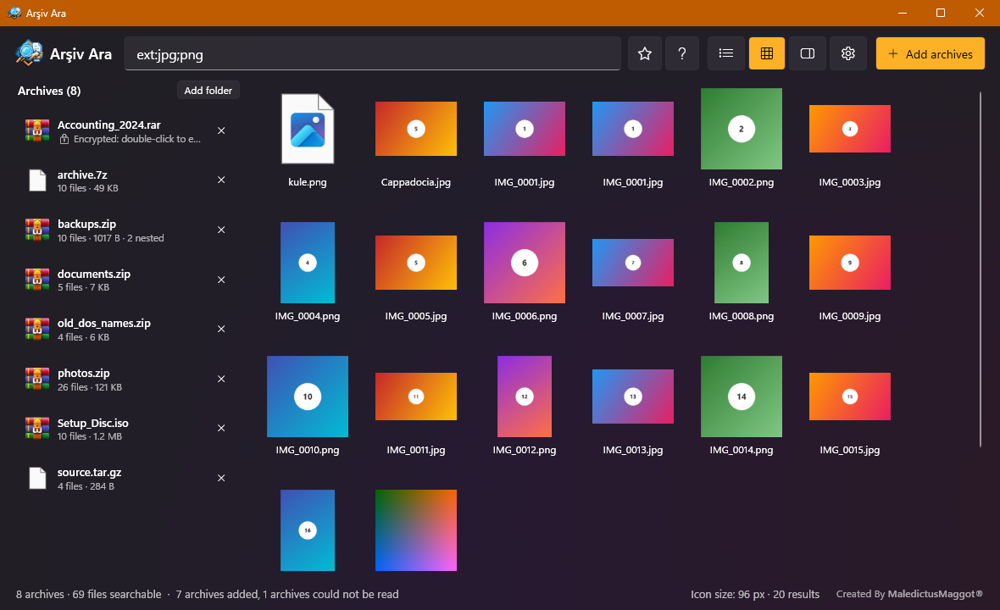
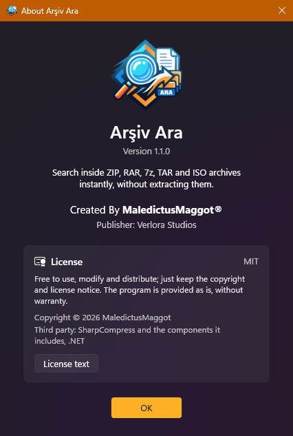

<div align="center">


# Arşiv Ara

**ZIP, RAR, 7z, TAR ve ISO arşivlerinin içinde, açmadan anında arama.**

Arşivlerinizi bırakın (ya da hepsini buldurun), birkaç harf yazın, eşleşen her dosyayı milisaniyeler içinde görün.

[English](README.md) · **Türkçe** · [Deutsch](README.de.md) · [Español](README.es.md)

[](https://github.com/ekink07/ArchiveSearch/releases/latest)
[](https://github.com/ekink07/ArchiveSearch/releases)
[](https://github.com/ekink07/ArchiveSearch/actions/workflows/ci.yml)


[](#lisans)


</div>

## Neden

Yedekler, proje klasörleri ve indirilenler zamanla onlarca büyük arşive dönüşür. Tek bir dosyayı bulmak için hepsini tek tek açmak gerekir.
Arşiv Ara arşivlerin yalnızca içindekiler listesini okur, bellekte tutar ve hepsinde aynı anda arama yapmanızı sağlar;
[Everything](https://www.voidtools.com/)'in diskteki dosya adlarında yaptığı gibi.

## Özellikler

| | |
|---|---|
| **Sürükle-bırak ya da tüm diskler** | Arşivleri ya da klasörleri pencereye (veya exe'nin üzerine) bırakın ya da bilgisayardaki tüm arşivleri buldurun. Yeni ve değişen arşivler canlı izlenir. |
| **Anında arama** | 1 milyon dosya adında arama 2–20 ms sürer. Her tuşta sonuçlar güncellenir. |
| **Arama dili** | VEYA `a\|b`, DEĞİL `!taslak`, `"tam ifade"`, joker `*.pdf`, `boyut:`, `tarih:`, `regex:`, `kopya:`, `icerik:`. Aramalar `Ctrl + S` ile kaydedilir. |
| **Türkçe duyarlı eşleştirme** | Büyük/küçük harf ve aksan duyarsız: `sirket` yazınca `Şirket`, `istanbul` yazınca `İSTANBUL` bulunur. DOS (CP857) adlı eski ZIP'ler doğru okunur. |
| **Biçimler** | ZIP, RAR (çok parçalı RAR4/RAR5 dahil), 7z, TAR (`.gz`, `.bz2`, `.xz`, `.zst`, `.tgz`), ISO (ISO 9660, Joliet, Rock Ridge, UDF). Arşiv içindeki arşivler de listelenir. |
| **Şifreli arşivler** | Dosya adları şifreli RAR ve 7z: çift tıklayıp parolayı girin; isterseniz Windows DPAPI ile hatırlanır. AES şifreli ZIP'ler parolasız listelenir, açarken parola sorulur. |
| **Önizleme paneli** | `Alt + P`: resimler, metin dosyaları, Word, Excel, PowerPoint ve OpenDocument metni; ayrıca aynı dosyanın diğer sürümleri. |
| **Sürümler ve kopyalar** | Sağ tık › *Sürümler* bir dosyanın en yeni kopyasının hangi yedekte olduğunu gösterir; `kopya:` aynı içerikli dosyaları boyut ve CRC ile bulur. |
| **Çıkar ve sürükle** | `Ctrl + E` seçilenleri bir klasöre çıkarır; sonuçları doğrudan Gezgin'e sürükleyebilirsiniz. |
| **Liste, kareler, sıralama** | Windows simgeleri, fotoğraf küçük resimleri, `Ctrl + tekerlek` ile 16–256 px. Sütun başlığına tıklayıp ada, klasöre, boyuta, tarihe ya da arşive göre sıralayın. |
| **Güvenli** | Çıkarılan dosyalar arşivin "web işaretini" (Mark of the Web) korur; program ve betikler (`.exe`, `.js`, `.ps1`…) açılmadan önce onay ister. Tamamen çevrimdışı. |
| **Taşınabilir, 4 dil** | x64 ya da ARM64 için tek exe; kurulum ve .NET gerekmez. Varsayılan dil İngilizce; Türkçe, Deutsch ve Español *Ayarlar*dan seçilir. |

## Kurulum

**PowerShell (tek satır)**: x64 ya da ARM64 sürümünü seçer, SHA256 ile doğrular, `%LOCALAPPDATA%\Programs\ArsivAra` klasörüne kurar,
Başlat menüsüne ve *Ayarlar › Uygulamalar* listesine ekler (kaldırma da oradan). Yönetici yetkisi gerekmez.

```powershell
irm https://raw.githubusercontent.com/ekink07/ArchiveSearch/main/install.ps1 | iex
```

Seçeneklerle (`-Desktop` masaüstü kısayolu, `-Uninstall` kaldırma, `-Uninstall -RemoveData` ayarlar ve kütüphaneyle birlikte kaldırma):

```powershell
& ([scriptblock]::Create((irm https://raw.githubusercontent.com/ekink07/ArchiveSearch/main/install.ps1))) -Desktop
```

**winget**

```powershell
winget install VerloraStudios.ArsivAra
```

(Paket winget deposuna kabul edildikten sonra kullanılabilir.)

**Elle**: [son sürümden](https://github.com/ekink07/ArchiveSearch/releases/latest) `ArsivAra.exe` (x64) ya da `ArsivAra-arm64.exe` dosyasını indirip çalıştırın.
Komut satırı aracı da orada: `ArsivAra.Cli.exe` (x64) ya da `ArsivAra.Cli-arm64.exe`.

**Taşınabilir**: exe'nin yanına boş bir `portable.txt` koyarsanız (ya da USB bellekten çalıştırırsanız) ayarlar ve kütüphane yanındaki
`ArsivAra-veri` klasöründe tutulur. Aksi hâlde `%LOCALAPPDATA%\ArsivAra` içindedir.

## Kullanım



| Sorgu | Ne bulur |
|---|---|
| `fatura 2024` | İki kelime de arşiv içindeki yolda geçmeli (VE) |
| `rapor\|sunum` | Biri yeterli (VEYA) |
| `!taslak` | Bunu içermeyenler (DEĞİL) |
| `"hesap özeti"` | Tam ifade, boşluk dahil |
| `*.pdf`, `IMG_00??.jpg` | Dosya adında joker karakterler |
| `ext:pdf;docx` | Sadece bu uzantılar |
| `arsiv:yedek` | Sadece adında ya da yolunda "yedek" geçen arşivler |
| `klasor:` / `dosya:` | Sadece klasörler / sadece dosyalar |
| `ad:="Rapor.pdf"` | Tam dosya adı |
| `boyut:>10mb`, `boyut:1mb..1gb` | Boyut |
| `tarih:2024`, `tarih:>=2024-06-01`, `tarih:buhafta` | Değiştirilme tarihi (`bugun`, `dun`, `gecenhafta`, `buay`…) |
| `regex:^fatura_\d+` | Düzenli ifade |
| `kopya:` | Aynı içerikli kopyalar (boyut ve CRC) |
| `icerik:zümrüt` | Metin ve Office dosyalarının içinde; yavaştır, diğer koşullarla daraltın |

İngilizce anahtarlar da çalışır: `archive:`, `folder:`, `file:`, `name:`, `size:`, `date:`, `dupe:`, `content:`. Arama kutusunun yanındaki **?** düğmesi aynı listeyi gösterir.

| Tuş | İşlem |
|---|---|
| `Ctrl + F` | Arama kutusuna git |
| Arama kutusunda `↓` / `Enter` | Sonuçlara geç / ilk sonucu aç |
| `Enter` / çift tık | Seçili dosyayı aç |
| `Ctrl + E` | Seçilenleri bir klasöre çıkar |
| `Ctrl + C` | Tam yolu kopyala |
| `Alt + P` | Önizleme panelini aç/kapat |
| `Ctrl + S` | Aramayı kaydet |
| `Ctrl + tekerlek`, `Ctrl +` / `Ctrl −` | Simgeleri büyüt/küçült (48 px ve üstü kareli görünüm) |
| `Ctrl + 0` | Sıkı listeye dön |
| `Esc` | Önce aramayı, sonra arşiv filtresini temizle |
| `Ctrl + O` | Arşiv ekle |
| `Ctrl + ,` | Ayarlar: dil, disk taraması, iç içe arşivler, geçici dosyalar, kayıtlı parolalar |
| `F1` | Hakkında ve lisans |
| Arşiv listesinde `Delete` | Arşivi listeden kaldır |

Kenar çubuğunda bir arşive tıklarsanız arama yalnızca onun içinde yapılır; arama kutusu boşken arşivin tüm içeriği görünür.

## Neden hızlı

- **ZIP**: Dosyanın sonundaki *merkezi dizin* okunur, dosya verisine hiç dokunulmaz.
- **RAR5**: RAR her dosyanın başlığını kendi verisinin önüne yazar; listelemek normalde dosya başına bir disk atlaması demektir.
  WinRAR bu başlıkların bir *Quick Open* kopyasını arşivin sonuna da yazar. Arşiv Ara bu bloğu tek seferde okur ve her başlığı CRC32 ile doğrular
  ([biçim belgesi](https://www.rarlab.com/technote.htm)). Bu kaydı olmayan arşivlerde [SharpCompress](https://github.com/adamhathcock/sharpcompress) kullanılır.
- **ISO**: UDF ve ISO 9660 dizin kayıtları doğrudan okunur; diski bağlamak gerekmez.
- **Arama**: Tüm yollar küçük harfe çevrilip aksanlarından arındırılarak tek bir UTF-8 tampona yazılır ve bu tampon vektörize `IndexOf` ile paralel taranır.
- **Tüm diskler**: NTFS'te arşiv dosyaları MFT'den bulunur (küçük bir yönetici yardımcı süreci; pencerenin kendisi yönetici olmadan çalışır) ve USN günlüğüyle güncel tutulur.
- **Harici HDD**: Döner disklerdeki arşivler tek tek okunur; paralel okuma diskin kafasını dosyalar arasında gezdirip yavaşlatır.

## Kaynaktan derleme

Windows'ta [.NET 10 SDK](https://dotnet.microsoft.com/download/dotnet/10.0) gerekir (`winget install Microsoft.DotNet.SDK.10`); `global.json` onu seçer.

```powershell
git clone https://github.com/ekink07/ArchiveSearch.git
cd ArchiveSearch
dotnet run --project src/ArsivAra.App -c Release
dotnet test tests/ArsivAra.Core.Tests        # gerçek örnek arşivlerle birim testleri
pwsh tests/ui/ui-smoke.ps1                   # UI Automation ile arayüz duman testi (Release derlemesi)
```

Taşınabilir tek dosya exe (ARM64 için `-r win-arm64`):

```powershell
dotnet publish src/ArsivAra.App -c Release -r win-x64 --self-contained true -p:PublishSingleFile=true -p:EnableCompressionInSingleFile=true -p:IncludeNativeLibrariesForSelfExtract=true -o publish
```

| Klasör | İçerik |
|---|---|
| `src/ArsivAra.Core` | Arşiv okuyucular (ZIP, RAR5 Quick Open, ISO/UDF, SharpCompress), indeks dosyası, sorgu dili, arama motoru |
| `src/ArsivAra.App` | Windows 11 (Fluent) temalı WPF arayüzü |
| `src/ArsivAra.Cli` | Komut satırı aracı: `index`, `search`, `extract`, `watch`, `lisans` |
| `src/ThirdParty` | SharpCompress 0.50.4 kaynak kodu (RAR, 7z, TAR, XZ, BZip2 ve Zstandard çözücüleri), bkz. [README](src/ThirdParty/README.md) |
| `tests/` | WinRAR, 7-Zip ve IMAPI2 ile üretilmiş örnek arşivlerle xUnit testleri; arayüz duman testi |
| `tools/` | Simgeler, ekran görüntüleri ve paylaşım kartı ve test arşivleri |

## Sınırlar

- Dosya adları şifreli arşivler parola girilmeden listelenemez.
- İç içe arşivler bir seviye derinliğe kadar, arşiv başına en çok 64 ve her biri 256 MB'a kadar okunur.
- `icerik:` sadece düz metin ve Office dosyalarına bakar (PDF yok); büyük solid arşivlerde yavaş olabilir.
- Hızlı tüm disk taraması NTFS ve yönetici izni ister; izin verilmezse klasörler gezilerek, daha yavaş taranır.

## Lisans

Arşiv Ara, [MIT lisansıyla](LICENSE) ücretsiz ve açık kaynaktır: telif hakkı bildirimi ve lisans metni korunduğu sürece kullanabilir,
kopyalayabilir, değiştirebilir, birleştirebilir, yayımlayabilir, dağıtabilir, alt lisans verebilir ve satabilirsiniz. Yazılım garantisiz sunulur.

| | |
|---|---|
| **Üretici** | Verlora Studios |
| **Yapımcı** | MaledictusMaggot |
| **Telif** | © 2026 MaledictusMaggot |
| **Üçüncü taraf bileşenler** | [SharpCompress](https://github.com/adamhathcock/sharpcompress) 0.50.4, kaynak kod olarak [src/ThirdParty](src/ThirdParty/README.md) içinde (MIT; içinde unRAR, Ms-PL, Apache 2.0, BSD ve zlib lisanslı kodlar var) ve taşınabilir sürümde .NET çalışma zamanı (MIT). Tüm metinler: [THIRD-PARTY-NOTICES.txt](THIRD-PARTY-NOTICES.txt). |

Aynı bilgiler programda **Hakkında › Lisans metni** (`F1`) altındadır; `ArsivAra.Cli lisans` komutu da konsola yazar.



---

<div align="center">

<br>
<sub>Verlora Studios · Created By <b>MaledictusMaggot®</b></sub>

</div>
